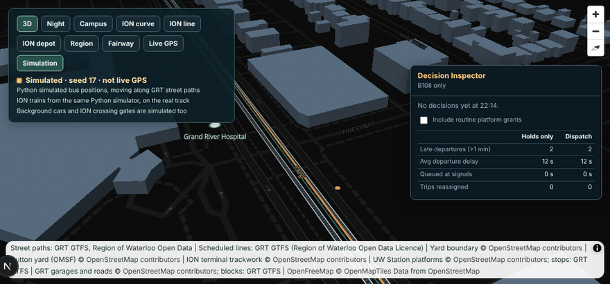

# Ordinary runs: fresh seeds, natural incidents, replay

An ordinary run, started with **Apply & restart** without a preset, draws a new seed. Incidents happen during it, drawn from that seed. The seed appears on the map's simulation badge and in the run report, and **Replay seed** runs it again exactly, with any dispatcher orders. Presets stay fixed test scenarios, with their own seed and no random incidents.

- Generator: `backend/incidents.py`; applied in `backend/simulation_engine.py` (`_incident`).
- API: `incidents: "natural"`, `incident_rates`, `seed`; the response carries `incidents` (the drawn list) and, per policy, `incidents` (each one applied or not, and why) and `report`.
- Tests: `backend/tests/test_incidents.py` and `frontend/e2e/verify-incidents.mjs`.

## Generation is separate from decisions

The incident list is drawn once, from the seed, the run length and the rates, before any driver or dispatcher acts. Both policies (holds only and adaptive) receive the same list. Each policy then records whether each incident applied in its own run, and why not. For example, the targeted bus may already have been withdrawn or be laying over.

Targets come from the schedule, not from the outcome. A Route 7 breakdown names a block that has a trip scheduled at that minute, and a corridor breakdown names one of the run's buses by number.

| Incident | Rate per hour (modelled) | What happens |
| --- | --- | --- |
| Bus breakdown | 0.30 | the bus is withdrawn ([regional-fleet.md](regional-fleet.md)); its riders walk to the next stop; dispatch sends a ready spare from the garage that can reach the relief point first |
| ION train fault | 0.10 (at most one a run) | a train arriving at the named terminal from that minute is withdrawn to Dutton yard (`rail_ops.py`) |
| Passenger surge | 0.25 | 60–180 riders arrive at once at UW Station |
| Station delay | 0.30 | a Route 7 station stop's berths are unavailable for 5–12 minutes |
| Driver errors | 4 % per opportunity at UW; 0.2 % per stop on a line | overshoots, missed berths, wrong turns, missed stops ([driver-agents.md](driver-agents.md)) |

The rates can be changed per run (`incident_rates`). Nothing is drawn in the first five minutes.

Stations keep reporting queues, available seats, blocked berths and predicted transfers from what is known at that moment, and drivers and dispatch react to what follows. When a station asks for capacity and the corridor's yard is empty, the adaptive dispatcher may now bring a ready spare from a garage. That rule is on for ordinary runs (`capacity_spares: 1`, at most one every 20 minutes) and off for presets and the API's default, so earlier results are unchanged.

## Replay (acceptance 5)

The same seed and the same dispatcher orders reproduce the same incidents, decisions and report; `test_same_seed_and_orders_replay_exactly` compares the whole response. Each run reports, for both policies:

| Measure | From |
| --- | --- |
| Trips covered | Route 7 trips scheduled to start in the run that started |
| Departure delays | average and largest, at each trip's first stop |
| Missed stops | Route 7 and UW Station |
| Transfers boarded | ION → bus, on the corridor and on Route 7 |
| Riders still waiting | at the end of the run, corridor and Route 7 |

Seed 11, 120 minutes, natural incidents: two Route 7 breakdowns (B108 at 07:53, B256 at 08:29), each covered by a spare from a garage; a 110-rider surge at UW at 08:09; Borden Station's berths unavailable for 10 minutes from 08:30; and driver errors drawn from the same seed, including missed stops by B132 and B107, an overshoot by B102 and a wrong turn by B104.

## A driver's mistake changes what another vehicle does

This is the "Route 7: driver misses a stop" preset, seed 17, three corridor buses. At 07:52:32, B108 misses the lane change at Grand River Hospital Station (stop 2540) and passes it. Four riders are waiting there, and one wanted to get off. The four wait for the next bus. At 08:08, B112 boards 13 riders there instead of 9; its decision names B108 and the cost: 10 s more dwell, and 16 minutes' extra wait for those riders. B112 then runs 10–12 s later at every stop to Borden.

The recording was made with `e2e/record-motion.mjs`, which steps the paused timeline frame by frame.

## The map

- **Fairway** opens the running simulation at Fairway Station, the ION terminal and Route 7's terminus. If nothing is running yet, it starts a run. The scripted Fairway replay, with its data, builder, tests and recordings, is removed.
- `?fixed=1` restores the original fixed scenario (seed 17, no random incidents, no capacity spares) for checks that compare a run with the API; the browser checks other than `verify-incidents.mjs` use it.
- **Live GPS** shows only the GRT public feed. **Simulation** shows only simulated vehicles, badged "Simulated · seed N · not live GPS".
