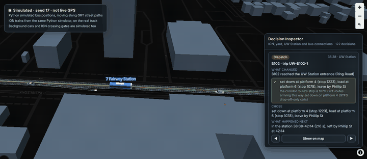

# Route 7 driven by the simulator

Route 7's buses are now driven, not timed. Every half second the simulator chooses each bus's speed and moves it along its GTFS shape. The map draws exactly that motion: the speed and position a bus has on the map at any instant are the ones the simulator gave it.

The schedule, the stops, the blocks and the vehicle IDs are still Route 7's from GTFS ([regional-lines.md](regional-lines.md)). What has changed is how a bus gets from one stop to the next, and what it does at each stop.

- Driver: `backend/line_driver.py` (speed choice, braking to a stop, the trace).
- Line: `backend/lines.py` (stops, doors, berths, the shared-traffic zones, decisions).
- Shared traffic: `backend/road_traffic.py` (`Lane`, the UW Station lane rules generalised to any street).
- Data: `tools/waterloo_geometry/build_lines.py` (curve speed limits, zone geometry from GTFS and OSM).
- Playback: `frontend/lib/motion/lines.ts`; drawing: `frontend/app/components/GeospatialMap.tsx`.
- Tests: `backend/tests/test_route7_driving.py`, `frontend/e2e/verify-route7-driving.mjs`.

## The motion is the corridor buses'

The yellow corridor buses (`backend/corridor.py`) and Route 7 use the same values:

| | Value | From |
| --- | --- | --- |
| Pull-away | 0.9 m/s² | `corridor.BUS_ACCEL` |
| Service braking | 1.1 m/s² | `corridor.BUS_DECEL` |
| Cruising cap | 16 m/s (58 km/h), up to 24 m/s to keep the schedule | `BUS_TOP_SPEED`, `BUS_RUSH_SPEED` |
| Curves | speed cap from the shape's curvature at 1.4 m/s² lateral, braking ahead of each | as the corridor |
| Run between two stops | the cruising cap is fitted so the run takes its scheduled share of time | `corridor.Run`, as the corridor fits its runs |

A bus is never faster than its cap, the curve ahead allows, or the vehicle ahead allows. Following another bus or a car uses the UW Station following rule (`road_traffic.following_speed`).

The GTFS shapes have small kinks that would read as sharp curves. The builder simplifies each shape (2.5 m tolerance) and rounds its corners to an 11 m radius, the turning radius of a 12 m bus. Every Route 7 stop stays within 16.2 m of its shape.

## At a stop

| Phase | What the bus does | Value |
| --- | --- | --- |
| Approach | brakes progressively at the service rate so it reaches the creep point at creep speed | 1.1 m/s² |
| Creep | the last metres into the stopping position | 3 m at no more than 0.8 m/s (modelled) |
| Stop | comes to a full stop on the stop's position | |
| Doors | open only once it is stationary | 1 s after stopping (modelled), then 3 s to open as before |
| Dwell | riders off and on, then the doors close | as [regional-lines.md](regional-lines.md) |
| Pull out | waits for a gap where traffic is modelled, then pulls away | 0.9 m/s² |

The driver never brakes harder than 2.5 m/s² (modelled), even for a vehicle ahead. At a curbside stop the map moves the bus from its lane (1.9 m right of the street's centreline) to the curb (3.4 m), blended over the 25 m before and after the stop. A bus that passes a stop because nobody is waiting stays in its lane.

## Shared traffic, by the UW Station lane rules

Two places on Route 7 have cars modelled in the same lane as the bus. Each is a lane of the kind UW Station uses (`road_traffic.Lane`): cars arrive at random from the seed, follow each other by the UW following rule, and treat the bus as a vehicle in the lane.

| Zone | Where | Geometry | What the bus must do |
| --- | --- | --- | --- |
| Curbside stop | King / Kitchener-Waterloo Collegiate (2542), towards Fairway | 500 m of King Street from the GTFS shape; the bus leaves the lane 20 m before the stop | pull out of the curb into a gap in King Street traffic |
| Terminal bay | Fairway Station (3490), towards Conestoga | the bay exit onto Fairway Road South; the road from OSM | stop at the bay exit and yield to Fairway Road South traffic (modelled stop line) |

Pulling out uses the UW merge rule (`Lane.merge_blockers`). The bus needs:
- at least 2.4 m plus 3 s at the approaching car's speed behind it;
- 2.4 m clear ahead of its own front.

Until then it waits, and the decision names every car that stopped it. For example:

> **B112** · Pulling out of the curbside stop at King / Kitchener-Waterloo Collegiate
> Control: the UW Station lane rule: room for the whole bus ahead, and 2.4 m plus 3 s at the approaching car's speed behind
> Outcome: pulled out at 08:09:59 after waiting 54 s; blocked by king-kci-car-404, king-kci-car-405, king-kci-car-406, …

Cars run at up to 50 km/h. The flow is a setting ("Route 7 shared traffic" in the scenario panel; `line_cars` in the API):

| Setting | Cars an hour (modelled) |
| --- | --- |
| light | 250 |
| moderate (default) | 500 |
| heavy | 900 |

The scenario button **Route 7: traffic at a curb and a bay** runs heavy traffic.

## What the map draws

The simulator records each bus's `[time, distance along the shape, speed]` every half second. Samples that constant acceleration between their neighbours reproduces (within 3 cm and 0.03 m/s) are dropped, which leaves about a fifth of them (19 % in the heavy-traffic run). The map reconstructs the motion between the kept samples: position lands exactly on each sample, and speed changes linearly between them.

Each Route 7 bus is drawn with the GRT bus icon and a label with its route number and destination ("7 Fairway Station", "7 Conestoga Station"). A bus running out of service to take over a block is labelled "Not in service". The cars in the two zones are the simulator's own; the decorative traffic on those lanes is hidden so as not to draw two sets of cars.

## Proof at 1× (`verify-route7-driving.mjs`)

The e2e test runs the heavy-traffic scenario, picks the longest wait at each zone, and plays it back at 1×. It samples the map every frame, on desktop and on a phone. At the bay, the bus boards at the Fairway platform, drives the bay roadway, and brakes to the stop line at the bay exit, where it waits:

| Check | Curbside stop (B112, King / KCI) | Terminal bay (B131, Fairway) |
| --- | --- | --- |
| Playback rate | 95.0 s simulated in 95.0 s | 153.0 s in 153.0 s |
| Braking | 49 → 0 km/h over 17.6 s, through every km/h in between, mean 0.78 m/s² | 33 → 0 km/h over 16.6 s, mean 0.55 m/s² |
| Creep | ≤ 0.81 m/s over the last 3 m (phone: up to 0.85) | ≤ 0.82 m/s (phone: up to 0.85) |
| Doors | stationary for 1.0 s first | stationary at the platform through its layover, before the trip's doors open |
| Wait | 54 s; 11 cars pass within 60 m | 43 s; 11 cars pass |
| Roll out | 0 → 8.2 m/s, speed never falling | 0 → 8.2 m/s |
| Label | 7 Fairway Station | 7 Conestoga Station |

On the map, speed between kept samples is reconstructed, so a frame entering the creep can read a few cm/s above the simulator's 0.8 m/s. The test allows 0.9 m/s. The backend test checks the simulator's own samples against 0.8 m/s plus 0.3.

## Calibration

The run between two stops is fitted to `RUN_SHARE` 0.68 of its scheduled time; the rest is for dwell. A driver running late takes `CATCH_UP` 0.5 of the lateness out of each segment, but never runs faster than the corridor rules allow.

Median terminal arrival, 120 min from 07:30, seed 17, default traffic:

| Direction | Median arrival |
| --- | --- |
| Towards Conestoga Station | +0.1 min |
| Towards Fairway Station | +3.2 min |

Towards Fairway, the schedule leaves less time than the motion rules need. The scheduled run times there are shorter than accelerating, cruising at no more than 24 m/s, braking and dwelling allow. So that direction arrives about 3 minutes late, and the 3-minute layover at Fairway absorbs it: departure delays are unchanged (18 s average). The model does not hide this by letting the bus drive faster than the corridor buses.

## Modelled, not observed

| Item | Value |
| --- | --- |
| Creep | the last 3 m at no more than 0.8 m/s |
| Doors after stopping | 1 s |
| Hardest braking | 2.5 m/s² |
| Curb offset | 3.4 m from the centreline (lane 1.9 m), blended over 25 m |
| Shape smoothing | 2.5 m simplification, 11 m corner radius |
| Zone car flows | 250 / 500 / 900 an hour; 50 km/h |
| Fairway bay stop line | at the bay exit, 262 m along the pattern |
| King / KCI pull-in | leaves the lane 20 m before the stop |
| Run share, catch-up | 0.68, 0.5 (calibration) |

Map data © OpenStreetMap contributors, available under the Open Database Licence (ODbL). Contains information provided by the Regional Municipality of Waterloo under the Region's Open Data Licence (GRT GTFS bus feed).
